<picture>
  <source media="(prefers-color-scheme: dark)" srcset="assets/banner-dark.svg">
  <source media="(prefers-color-scheme: light)" srcset="assets/banner-light.svg">
  
</picture>

## About

I lead quality engineering at a fintech company in Indonesia. Much of my work is replacing spreadsheet processes with small web tools that run their full test suite before every deploy.

### Working on

- A UAT tracking dashboard that replaced a shared spreadsheet as the team's system of record
- Edge-hosted web apps on Cloudflare Workers with Postgres behind them
- Engineering with AI agents, where every change is still reviewed before it merges

### What I care about

- Test design that catches the regression before a user does
- Interfaces that are accessible and written in plain language
- Small changes that are easy to review and easy to roll back

### Tools

JavaScript, React, Node.js, PostgreSQL, Cloudflare Workers, Vite, Tailwind CSS

<b>How I work</b>

- Ship in small, reviewed steps; nothing merges unless the tests pass
- Write a rule down where the next person will look for it
- Measure before optimizing

